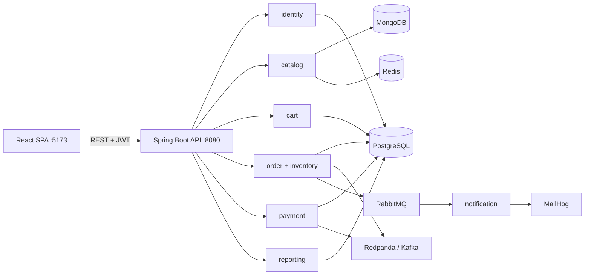

# SpringMarket

SpringMarket is a learning-oriented marketplace built as a Spring Boot modular
monolith with a React SPA. It demonstrates persistence across PostgreSQL and
MongoDB, Redis caching, JWT security, transactional checkout, simulated
payments, Kafka events, RabbitMQ notifications, Spring Batch, and
Testcontainers.

## Architecture



The backend is one deployable application. Packages are module boundaries, and
cross-module calls stay explicit through services and event publishers.

## Module map

| Module | Responsibility | Main storage/integration |
| --- | --- | --- |
| `identity` | Registration, login, JWT access tokens, refresh rotation | PostgreSQL |
| `shared.security` | Stateless authentication and role authorization | JWT |
| `shared.error` | RFC 9457 problem-detail responses | Spring MVC |
| `catalog` | Products, reviews, paged catalog cache | MongoDB, Redis |
| `cart` | Buyer carts with price snapshots | PostgreSQL |
| `inventory` | Stock initialization, reservation, release | PostgreSQL |
| `order` | Transactional checkout and order state transitions | PostgreSQL, Kafka, RabbitMQ |
| `payment` | Simulated idempotent charges | PostgreSQL, Kafka |
| `notification` | Order-confirmation queue, DLQ, and email | RabbitMQ, MailHog |
| `reporting` | Daily-sales batch job and admin endpoint | Spring Batch, PostgreSQL |
| `frontend` | Buyer, seller, and admin workflows | React, Vite |

## Run locally

Requirements: Java 21 or newer, Docker with Compose, and Node.js/npm.

```bash
cp .env.example .env
docker compose up -d

JWT_SECRET='change-me-to-a-long-random-string-at-least-32-chars' \
  ./backend/mvnw -f backend/pom.xml spring-boot:run
```

Compose reads the `POSTGRES_*` values from `.env`. `JWT_SECRET` is supplied
separately to the Spring Boot JVM by the command above; it is not consumed by
the infrastructure-only Compose services.

In another terminal:

```bash
cd frontend
npm install
npm run dev
```

Useful URLs:

- SPA: <http://localhost:5173>
- Swagger UI: <http://localhost:8080/swagger-ui.html>
- OpenAPI JSON: <http://localhost:8080/api/v1/api-docs>
- Health: <http://localhost:8080/actuator/health>
- MailHog: <http://localhost:8025>
- RabbitMQ management: <http://localhost:15672> (`guest` / `guest`)

### Port conflicts and PostgreSQL credentials

Compose binds PostgreSQL `5432`, MongoDB `27017`, Redis `6379`, Redpanda
`9092`, RabbitMQ `5672`/`15672`, and MailHog `1025`/`8025`. If one is occupied,
stop the process using it or change the host side of that service's mapping,
for example `"15432:5432"`. When remapping a dependency, update the matching
host/port in `backend/src/main/resources/application-local.yml` (or supply the
equivalent Spring environment property).

An existing, unrelated PostgreSQL server on `localhost:5432` will conflict and
may also reject the `springmarket` credentials. Stop it, remap Compose, or point
the backend at the intended database. A fresh Compose volume initializes:

- database: `springmarket`
- user: `springmarket`
- password: `springmarket`

If you previously initialized the named `pgdata` volume with other credentials,
those credentials persist. Preserve the data and use its original credentials,
or intentionally recreate local data with `docker compose down -v` before
starting again.

### What “full local” means

`docker compose up -d` starts the complete development topology: PostgreSQL,
MongoDB, Redis, Redpanda (Kafka-compatible), RabbitMQ, and MailHog. The
`CheckoutFlowIT` Testcontainers test uses the smaller PostgreSQL + MongoDB +
Redis subset. Kafka and RabbitMQ transport clients are mocked there while the
real application publishers and checkout transaction are exercised.

## Tests

```bash
cd backend
./mvnw test

cd ../frontend
npm test
npm run lint
npm run build
```

Docker must be running for `CheckoutFlowIT`. The Maven test configuration sets
`-Dnet.bytebuddy.experimental=true` (required for Mockito/Byte Buddy on Java 25)
and `-Dapi.version=1.44` (Docker Engine 29 rejects older Docker API versions that
docker-java would otherwise negotiate). If invoking a test outside Maven's
configured Surefire process, pass those JVM options explicitly.

## Learning path

Follow the implementation sequence; each step builds on the previous module:

1. **Backend scaffold and Compose** — application configuration, profiles,
   PostgreSQL, and a context test.
2. **Identity** — relational modeling, Flyway, password hashing, JWT access
   tokens, refresh rotation, and roles.
3. **Shared API concerns** — problem details, validation errors, and OpenAPI
   bearer authentication.
4. **Catalog** — MongoDB documents and repositories plus Redis list caching.
5. **Cart** — JPA aggregates and immutable price snapshots.
6. **Orders and inventory** — pessimistic stock coordination, transactions,
   order state transitions, and concurrent checkout.
7. **Payments** — deterministic simulated charging and idempotency keys.
8. **Kafka events** — post-commit domain events and idempotent consumers.
9. **Notifications** — RabbitMQ routing/DLQ, Spring Mail, and MailHog.
10. **Reporting** — Spring Batch daily-sales aggregation.
11. **Administration** — secured Actuator endpoints and admin order access.
12. **React foundations** — Vite, typed API client, auth context, and catalog.
13. **SPA workflows** — cart/checkout, order history, seller product creation,
    and admin reporting.
14. **Integration testing** — real database/cache dependencies with
    Testcontainers and an HTTP-level checkout flow.
